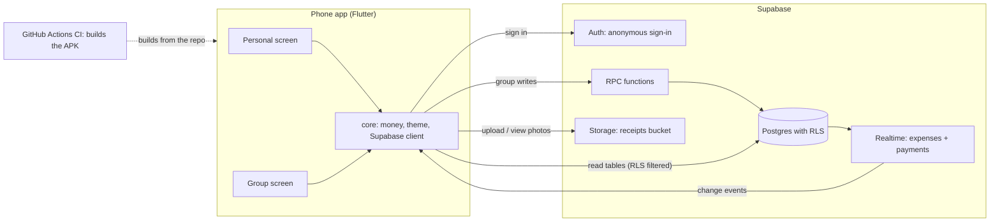
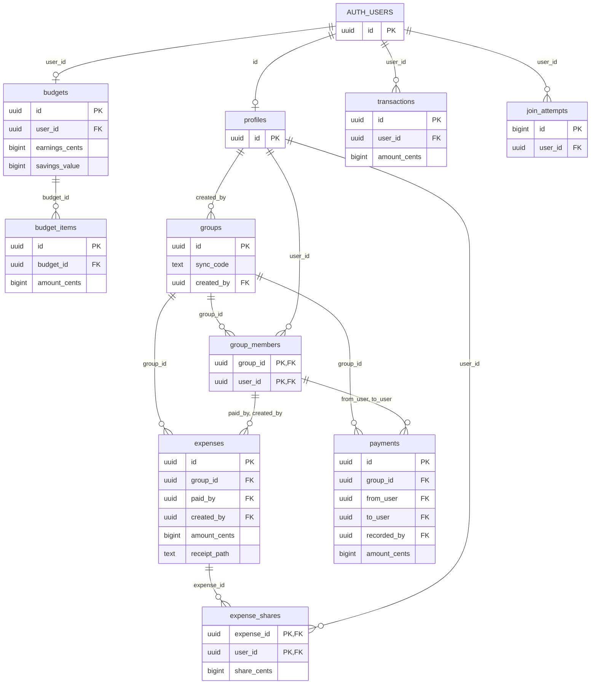
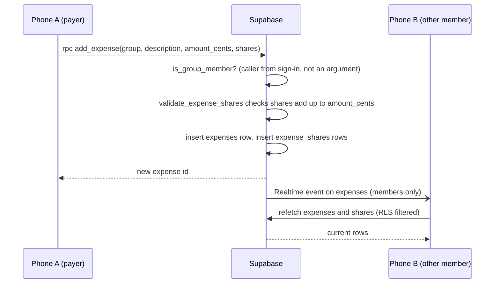
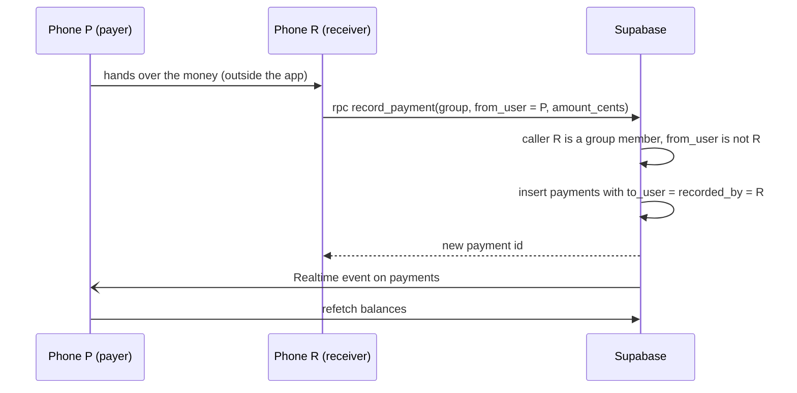

# Architecture

Trello card 1.9. For the table details and security rules see
[DATABASE.md](DATABASE.md).

## Overview

The phone app is Flutter. It has no server code of its own. It talks straight to
Supabase, which gives us anonymous sign-in, a Postgres database, file storage for
receipt photos, and live updates. The security rules live in the database
(row-level security, RLS), so a modified app still cannot read or write what it
should not. Every write to a group goes through a database function (RPC) that
checks who is calling. GitHub Actions builds the APK on every pull request.

## 1. Big picture

Personal budget tables (`budgets`, `budget_items`, `transactions`) are the one
exception to "writes go through RPCs": the owner writes them directly, and RLS
allows only the owner.

## 2. Tables

Key columns only. Money columns end in `_cents` (whole cents, `bigint`).
`AUTH_USERS` is Supabase's own `auth.users` table.

`paid_by`, `created_by`, `from_user` and `to_user` point at `group_members`
together with `group_id`, so the database itself refuses someone who is not in
the group. `recorded_by` also points at `profiles`, and a check forces it to
equal `to_user`.

## 3. Add a shared expense

The app does the even split (leftover cents to the first people) and sends the
result. The database only checks that it adds up. Realtime does not carry the
data we show, only the signal to refetch.

## 4. Paying someone back

`record_payment` has no argument for the receiver. It always uses the caller, so
the payer cannot record their own payment. Clients also have no direct insert
permission on `payments`, and the table's check `recorded_by = to_user` backs
this up.

## Who owns which folder

| Folder | Owner |
|---|---|
| `lib/core/` (themes, money, Supabase client) | Allen |
| `lib/features/personal/` | Malachi |
| `lib/features/group/` | Davante |
| `lib/features/balances/` | 4th member |
| `supabase/migrations/` | Allen |
| `test/` | mirrors `lib/`, same owner as the file under test |
